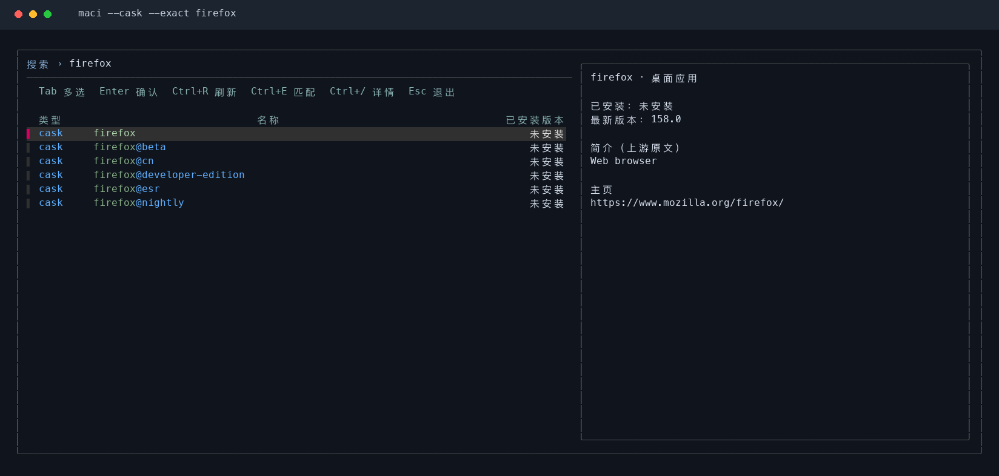

<h1 align="center">🍎 mactools</h1>

<p align="center">
  <strong>A macOS terminal toolkit — packages, cleanup, mirrors, and AI coding tools</strong>
</p>

<p align="center">
  <a href="https://github.com/tingfeng347/mactools/actions/workflows/ci.yml"></a>
  <a href="https://github.com/tingfeng347/mactools"></a>
  <a href="https://brew.sh/"></a>
  <a href="https://www.python.org/"></a>
  <a href="https://www.gnu.org/software/bash/"></a>
</p>

<p align="center">
  <a href="README.md">简体中文</a> · <strong>English</strong>
</p>

Ported from [ubtools](https://github.com/tingfeng347/ubtools). Use `ma + action` and shortcuts such as `maci` to manage Homebrew Formulae and Casks, environment diagnostics, mirrors, and AI coding tools.

```bash
ma install firefox
maci firefox                 # Same as ma install
ma update --list
ma ai install --all --dry-run
```

Supports Intel and Apple Silicon, works with macOS system Bash 3.2, and uses the Python 3.9+ standard library for its application logic.

## Interface demo

Search, selection, and package details: Blue marks official Homebrew sources; purple marks third-party taps. Types use `formula` / `cask`. the name heading is centered, package names are left aligned, and versions are right aligned. Use `Tab` to select multiple packages and `Ctrl+/` to toggle details.



Commands and shortcuts:


## Install and uninstall

Install with Homebrew to configure Python and fzf dependencies automatically:

```bash
brew install tingfeng347/tap/mactools
```

Alternatively, add the tap first:

```bash
brew tap tingfeng347/tap
brew install mactools
```

Upgrade or uninstall a Homebrew installation:

```bash
brew update
brew upgrade mactools
brew uninstall mactools
```

Tap: [tingfeng347/homebrew-tap](https://github.com/tingfeng347/homebrew-tap).

You can also clone the project and use the installer:

```bash
git clone https://github.com/tingfeng347/mactools.git
cd mactools
brew install python fzf       # Skip dependencies already installed
bash install.sh
```

If Homebrew, Python 3.9+, and fzf are already installed, use the standalone installer:

```bash
curl -fsSL https://raw.githubusercontent.com/tingfeng347/mactools/main/install.sh | bash
```

The script installs to `~/.local/bin` by default, without sudo. If this directory is missing from PATH, run the following and add it to your `~/.zshrc` as needed:

```bash
export PATH="$HOME/.local/bin:$PATH"
```

The installer can explicitly install dependencies or use a custom directory:

```bash
bash install.sh --install-deps
bash install.sh --bin-dir "$HOME/bin"
bash install.sh --dry-run
```

Install Homebrew separately using its [official instructions](https://brew.sh). The installer stages and validates all files before deploying commands and shared modules, and attempts to restore old files if deployment fails. You can also run `./bin/ma` or `./bin/maci` directly from the source directory.

```bash
bash uninstall.sh --dry-run
bash uninstall.sh
bash uninstall.sh --purge-cache
bash uninstall.sh --bin-dir "$HOME/bin"
```

The uninstaller removes only mactools commands and modules. It preserves applications, dependencies, AI logins and sessions, language settings, mirror snippets, and mirror backups. `--purge-cache` additionally removes the current user's mactools cache.

The standalone installer tries GitHub Raw and then jsDelivr, downloading and validating the full payload before deployment. Override download bases with `MACTOOLS_DOWNLOAD_BASES` (space separated).

## Commands and shortcuts

| Feature | Full command | Shortcut |
|---|---|---|
| Search and install packages | `ma install` | `maci` |
| Search and remove packages | `ma remove` | `macr` |
| Review and update packages | `ma update` | `macu` |
| Check environment, caches, and connectivity | `ma doctor` | `macd` |
| Preview and clean disk space | `ma clean` | `macc` |
| Benchmark, switch, and restore mirrors | `ma mirror` | `macm` |
| Manage AI coding tools | `ma ai` | `maca` |

```bash
ma --help
ma help mirror
ma update --help
ma --version
ma setup en                  # Save English as the interface language
ma setup zh                  # Save Chinese (the default)
```

`MACTOOLS_LANG=zh|en` temporarily overrides the saved language. Configuration defaults to `~/.config/mactools` and respects `XDG_CONFIG_HOME`.

## Search, install, remove, and update

```bash
maci firefox                 # Search Formula + Cask names and select interactively
maci --formula wget          # Command-line tools; --brew aliases --formula
maci --cask firefox          # macOS applications
maci --formula --cask python # Combine sources
maci --exact wget            # Contiguous substring matching; fuzzy by default
maci --list firefox          # List matches without opening the selector
maci --refresh               # Fetch the name catalog again

macr                        # Select multiple installed packages
macr --cask firefox
macr --dry-run firefox      # Show the removal plan after selection

macu                        # Select updates with current and target versions
macu --formula
macu --list                 # List available updates without changes
macu --dry-run              # Preview selected update commands
macu --refresh-index        # Confirm and run brew update before listing updates
```

Install, remove, and update operations display a plan and request confirmation. `--yes` skips only mactools confirmation; Homebrew retains its own transaction prompts. Commands never use `sudo brew`, and removal does not pass `--zap`.

The install selector shows package source, name, and installed version, with Homebrew details in the preview. The update selector shows installed and target versions. Search matches only names, excluding source, version, and installation status.

Keyboard hints and column headings appear on separate lines. Chinese mode distinguishes command-line tools and applications with localized labels. Wide terminals show details on the right; narrower terminals place them below. Preview labels follow the interface language, while package names and upstream descriptions retain their original text.

| Key | Action |
|---|---|
| `Tab` / `Shift+Tab` | Toggle selection and move down / up |
| `Enter` | Continue to the operation plan and confirmation |
| `Ctrl+R` | Refresh the current list |
| `Ctrl+E` | Switch between contiguous substring and fuzzy matching |
| `Ctrl+/` | Show / hide package details |
| `Esc` | Exit and stop background package queries |

Lists load in the background. The name catalog is cached for one hour; existing cache is shown first and can serve as a fallback if a query fails. Cache defaults to `~/Library/Caches/mactools` and respects `XDG_CACHE_HOME`. Installation status and available updates are read afresh each time. `--list` and `--dry-run` neither write mactools cache nor change packages.

Package queries time out after 15 seconds per request by default; adjust with `--timeout 30`. Only an explicit `ma update --refresh-index` refreshes the Homebrew index. It cannot be combined with `--list` or `--dry-run`.

## Diagnostics and cleanup

```bash
macd
macd --offline               # Local checks only
macd --formula --timeout 5

macc                         # Select cleanup actions, preview, then confirm
macc --list                  # List cleanup actions only
macc --dry-run               # Run native --dry-run previews without deleting files
macc --cask --dry-run
```

Diagnostics report dependencies, architecture, Homebrew prefix, Xcode Command Line Tools, package lists, cache age, and connectivity using `OK`, `WARN`, `FAIL`, or `SKIP`, with elapsed time. `FAIL` returns a nonzero exit status. Missing optional tools are marked `SKIP`; Homebrew's own recommendations are marked `WARN`.

Cleanup uses Homebrew's `cleanup --dry-run` and `autoremove --dry-run` for previews, then runs the corresponding native command after confirmation. It preserves application data and does not use `--zap`. Formulae and Casks can be filtered separately.

## Mirrors

```bash
macm                         # Benchmark, then confirm whether to apply
macm test                    # Benchmark only
macm test --json
macm auto --dry-run          # Preview the fastest mirror configuration
macm auto                    # Back up, confirm, and apply the fastest mirror
macm restore                 # Restore the most recent configuration
macm restore --dry-run
macm restore --force         # Explicitly allow overwriting manual snippet edits
```

Default candidates are official GHCR, Tsinghua, and USTC, with up to four concurrent checks. The benchmark uses the official Homebrew API to find a `hello` bottle, preferring the local architecture and falling back to another macOS architecture when unavailable (samples are never executed), verifies the complete sample's SHA-256, and compares download speeds using the same sample. Samples are limited to 8 MiB; results reflect small-file performance on the current network. The selected mirror's API is also checked before applying it.

```bash
macm test --mirror official --mirror tuna --timeout 5 --limit 4
macm test --mirror https://your-mirror.example/homebrew-bottles
```

Custom mirrors must provide standard Homebrew bottle paths. Automatic switching also requires Homebrew API endpoints under `/api`.

Mirror switching writes a dedicated `~/.config/mactools/mirrors.sh` snippet without automatically editing `.zshrc`. After completion, the command displays what to run in your current terminal:

```bash
source "$HOME/.config/mactools/mirrors.sh"
```

Add this `source` line to your shell configuration to enable it in new terminals. Backups default to `~/Library/Application Support/mactools` and respect `XDG_STATE_HOME`. Use `--config-dir` and `--state-dir` for isolated directories. Writes are locked and rolled back on failure. Restore validates the backup and current snippet, refusing to overwrite manual edits unless `--force` is explicitly supplied.

This changes bottle and API download domains. The Homebrew installer, third-party tap Git remotes, and upstream Cask download URLs remain managed by their respective projects. If official reference data cannot be fetched, benchmarking fails and preserves the existing configuration.

## AI coding tools

```bash
maca                         # Open the install selector
maca install codex claude opencode pi qodercn gemini qwen zcode
maca install --all --dry-run
maca status                  # Local versions, sources, and all installed copies
maca status --latest          # Also query the latest npm releases
maca update                  # Select installed tools to update
maca update codex --check     # Check upstream versions without updating
maca update --all
maca remove                  # Select copies to remove by installation path
maca remove codex --path "$HOME/.local/bin/codex"
maca remove --all --dry-run
maca doctor --offline
```


Supports Codex, Claude Code, OpenCode, Pi, Qoder CN, Gemini CLI, Qwen Code and official ZCode CLI. The selector matches `maci`, with a centered name heading, left-aligned names, aligned status/source columns and a details pane toggled with `Ctrl+/`.

Codex, Claude, OpenCode, Pi and Qoder CN use official installer scripts, downloaded before execution. Gemini and Qwen use official npm packages. Qoder CN recognizes both `qodercn` and the legacy `qoderclicn` binary. Updates follow the detected Homebrew, npm, pnpm, Bun or native installation method.

ZCode CLI follows the [official source-build workflow](https://github.com/zai-org/ZCode#readme). It requires Git, Node.js 24.14+ and the repository-pinned pnpm (currently 10.33.2); builds can take some time. The build runs in a temporary directory before switching the runtime under `~/.local/share/mactools/zcode` and creating `~/.local/bin/zcode`. Failed builds preserve the previous version; removal preserves `~/.zcode`. Preview with `maca install zcode --dry-run`.

Homebrew installations are identified by their actual target files, Formula/Cask names, and installation directories to avoid mixing Intel and Apple Silicon Homebrew installations. Symlinks to the same executable are merged into one entry; distinct copies are displayed separately. Unknown installation sources are not automatically updated or removed. Removal preserves client configuration, credentials, and sessions.

`status --latest` and `update --check` compare the official source version for ZCode and upstream npm SemVer for other tools, which can differ from Homebrew or native release channels. Without fzf, specify client names or `--all` directly. The AI selector supports `Tab` to toggle selection, `Ctrl+A` to select all, `Ctrl+D` to deselect all, `Enter` to continue, and `Esc` to exit.

## Shell completion

```bash
# Bash
source <(ma completion bash)

# Zsh
autoload -Uz compinit && compinit
source <(ma completion zsh)

# Fish
ma completion fish | source
```

Completion covers `ma` and all seven shortcuts, without network queries during completion.

## Porting and validation

The project was developed on three parallel feature branches, then reviewed and merged by an independent agent. See the [porting specification](docs/PORTING.md) for feature mapping and the [review report](docs/REVIEW.md) for the initial integration review. The original reference source is kept locally in `.reference/ubtools`, and parallel working directories are kept in `.worktrees`; neither directory is included in the public repository.

```bash
python3 -m unittest discover -s tests -v
```

Tests use temporary directories, fake package managers, local HTTP servers, and pseudo-terminals without installing, updating, or removing actual host software. Local regression checks cover real fzf name filtering and cleanup bindings. CI checks Python 3.9 and 3.13 on macOS and Linux; installer lifecycle tests run only on macOS. See the CI badge above for remote results.

The reference source is pinned to ubtools commit `e2a05261f07207590b3065fa447641c32b4afe0f`. macOS adaptation references: [Homebrew commands](https://docs.brew.sh/Manpage), [Homebrew JSON API](https://docs.brew.sh/Querying-Brew), [Tsinghua bottle mirror](https://mirrors.tuna.tsinghua.edu.cn/help/homebrew-bottles/), and [USTC bottle mirror](https://mirrors.ustc.edu.cn/help/homebrew-bottles.html).
