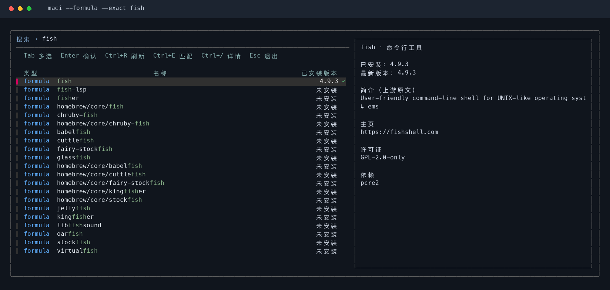
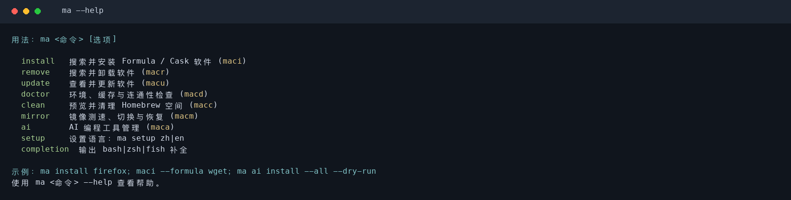
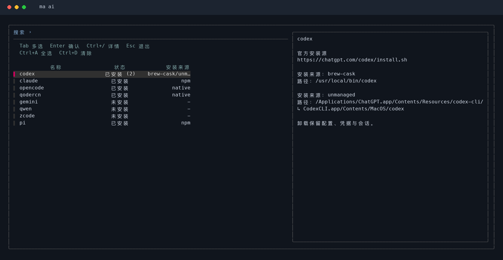

<h1 align="center">🍎 mactools</h1>

<p align="center">
  <strong>macOS 终端工具集 — 搜索安装、更新清理、镜像测速与 AI 编程工具管理</strong>
</p>

<p align="center">
  <a href="https://github.com/tingfeng347/mactools/actions/workflows/ci.yml"></a>
  <a href="https://github.com/tingfeng347/mactools"></a>
  <a href="https://brew.sh/"></a>
  <a href="https://www.python.org/"></a>
  <a href="https://www.gnu.org/software/bash/"></a>
</p>

<p align="center">
  <strong>简体中文</strong> · <a href="README.en.md">English</a>
</p>

移植自 [ubtools](https://github.com/tingfeng347/ubtools)，使用 `ma + 动作` 和 `maci` 等快捷命令，统一管理 Homebrew Formula / Cask、环境诊断、镜像源和 AI 编程工具。

```bash
ma install firefox
maci firefox                 # 与 ma install 相同
ma update --list
ma ai install --all --dry-run
```

支持 Intel 与 Apple Silicon，兼容 macOS 系统 Bash 3.2，业务逻辑使用 Python 3.9+ 标准库。

## 界面演示

搜索、选择与软件详情：蓝色标识为 Homebrew 官方源，紫色标识为第三方 tap；类型显示 `formula` / `cask`；名称为白色，已安装版本右侧显示绿色 `✓`。名称表头居中、软件名左对齐、版本靠右，`Tab` 多选，`Ctrl+/` 收起或展开详情。



完整命令和快捷入口：



## 安装与卸载

推荐通过 Homebrew 安装，自动配置 Python 与 fzf 依赖：

```bash
brew install tingfeng347/tap/mactools
```

也可以先添加软件源，再安装：

```bash
brew tap tingfeng347/tap
brew install mactools
```

Homebrew 安装的版本使用以下命令升级或卸载：

```bash
brew update
brew upgrade mactools
brew uninstall mactools
```

软件源：[tingfeng347/homebrew-tap](https://github.com/tingfeng347/homebrew-tap)。

也可以克隆项目，使用脚本安装：

```bash
git clone https://github.com/tingfeng347/mactools.git
cd mactools
brew install python fzf       # 已安装时可跳过
bash install.sh
```

已有 Homebrew、Python 3.9+ 和 fzf 时，也可以一行安装：

```bash
curl -fsSL https://raw.githubusercontent.com/tingfeng347/mactools/main/install.sh | bash
```

脚本安装默认部署到 `~/.local/bin`，不需要 sudo。如果该目录不在 PATH 中，在当前终端执行，并按需添加到自己的 `~/.zshrc`：

```bash
export PATH="$HOME/.local/bin:$PATH"
```

也可以由安装脚本显式安装依赖，或指定安装目录：

```bash
bash install.sh --install-deps
bash install.sh --bin-dir "$HOME/bin"
bash install.sh --dry-run
```

依赖 Homebrew 需自行按 [官方说明](https://brew.sh)安装。安装器会完整暂存并检查全部文件，再部署入口与共享模块；部署写入失败会尝试恢复旧文件。源码目录中也可以直接使用 `./bin/ma` 或 `./bin/maci`。

```bash
bash uninstall.sh --dry-run
bash uninstall.sh
bash uninstall.sh --purge-cache
bash uninstall.sh --bin-dir "$HOME/bin"
```

卸载只删除 mactools 自己的入口和模块；保留应用、依赖、AI 登录与会话、语言设置、镜像片段和镜像备份。`--purge-cache` 仅额外删除当前用户的 mactools 缓存。

安装脚本的独立下载模式按 GitHub Raw、jsDelivr 顺序尝试，完整下载并检查后再部署。下载地址可以用 `MACTOOLS_DOWNLOAD_BASES` 指定（空格分隔）。

## 完整命令与缩写

| 功能 | 完整命令 | 缩写 |
|---|---|---|
| 搜索并安装软件 | `ma install` | `maci` |
| 搜索并卸载软件 | `ma remove` | `macr` |
| 查看并更新软件 | `ma update` | `macu` |
| 环境、缓存和连通性检查 | `ma doctor` | `macd` |
| 预览并清理空间 | `ma clean` | `macc` |
| 镜像源测速、切换和恢复 | `ma mirror` | `macm` |
| AI 编程工具管理 | `ma ai` | `maca` |

```bash
ma --help
ma help mirror
ma update --help
ma --version
ma setup en                  # 保存英文设置
ma setup zh                  # 保存中文设置（默认）
```

`MACTOOLS_LANG=zh|en` 可临时覆盖保存的语言；配置默认位于 `~/.config/mactools`，遵循 `XDG_CONFIG_HOME`。

## 搜索、安装、卸载与更新

```bash
maci firefox                 # Formula + Cask 名称搜索，交互式选择
maci --formula wget          # 命令行工具；--brew 是 --formula 别名
maci --cask firefox          # macOS 应用
maci --formula --cask python # 可以组合来源
maci --exact wget            # 连续子串匹配；默认 fzf 模糊匹配
maci --list firefox          # 只列出匹配项，不进入交互
maci --refresh               # 重新获取名称目录

macr                        # 多选已安装软件
macr --cask firefox
macr --dry-run firefox      # 选择后只显示卸载计划

macu                        # 新旧版本列表，多选更新
macu --formula
macu --list                 # 只读列出可更新软件
macu --dry-run              # 只预览选中的更新命令
macu --refresh-index        # 先确认并执行 brew update，再查看更新
```

安装、卸载、更新都会显示操作计划并确认；`--yes` 仅跳过 mactools 的确认，保留 Homebrew 自己的事务提示。不会使用 `sudo brew`，卸载不传入 `--zap`。

安装界面展示来源、名称和已安装版本，预览区显示 Homebrew 软件详情。更新界面展示已安装版本和目标版本。搜索只匹配名称，来源、版本和安装状态不参与匹配。

界面将操作提示与列标题分行显示，中文模式以“工具 / 应用”区分软件类型。宽终端在右侧展示详情，较窄终端将详情放到底部；预览字段遵循界面语言，软件名称和上游简介保留原文。

| 按键 | 操作 |
|---|---|
| `Tab` / `Shift+Tab` | 多选 / 反向多选 |
| `Enter` | 进入操作计划与确认 |
| `Ctrl+R` | 刷新当前列表 |
| `Ctrl+E` | 切换连续子串 / 模糊匹配 |
| `Ctrl+/` | 显示 / 收起软件详情 |
| `Esc` | 退出并终止后台列表查询 |

`maci`、`macu`、`macr` 优先显示最近 24 小时内的列表快照，后台重新查询并动态替换列表；首次使用仍需加载数据。刷新期间可以继续搜索和多选，新版 fzf 会保留已选软件。提前按 Enter 时会等待后台核对完成，已卸载或不再需要更新的软件会跳过；缓存不会直接决定包变更。单独筛选 `--formula` / `--cask` 时也可复用完整列表缓存，实时查询只读取所需类型。切换详情会停止旧的预览查询，避免后台查询积压。名称目录缓存一小时，`Ctrl+R` 会强制刷新目录。缓存默认在 `~/Library/Caches/mactools`，遵循 `XDG_CACHE_HOME`。`--list` 始终读取实时状态，`--list` 与 `--dry-run` 不写工具缓存，也不执行包变更。

包查询默认每项超时 15 秒，可用 `--timeout 30` 调整。仅显式 `ma update --refresh-index` 会刷新 Homebrew 索引；它不能与 `--list` / `--dry-run` 组合。

Cask 的已安装版本优先采用应用自身的版本，无法读取时回退到 Homebrew 安装记录。详情分别列出当前版本、Homebrew 安装记录、Homebrew 可用版本和 tap 来源。应用自更新后，`macu` 会跳过能明确判定为相同或较旧的 Homebrew 版本；带构建号时也会核对构建号，无法可靠比较的格式继续沿用 Homebrew 的更新判断。这里的可用版本属于 Homebrew 渠道，可能落后于应用内更新。

## 诊断与清理

```bash
macd
macd --offline               # 仅本地检查
macd --formula --timeout 5

macc                         # 多选清理入口，先原生预览再确认
macc --list                  # 只列出清理入口
macc --dry-run               # 执行原生 --dry-run 预览，不删除文件
macc --cask --dry-run
```

诊断按 `OK` / `WARN` / `FAIL` / `SKIP` 输出依赖、架构、Homebrew 前缀、Xcode Command Line Tools、包列表、缓存年龄与联网结果，并显示耗时。`FAIL` 返回非零状态；缺失的可选工具记为 `SKIP`，Homebrew 自身的建议记为 `WARN`。

清理使用 Homebrew 自己的 `cleanup --dry-run`、`autoremove --dry-run` 展示预览。确认后执行对应原生命令；不清除应用数据，不使用 `--zap`。Formula 和 Cask 可分别筛选。

清理菜单直接打开，选择后才读取对应类型的软件列表；预览只查询当前项目，单独选择 `autoremove` 时无需读取软件列表。执行前生成实时清理计划。

## 镜像源

```bash
macm                         # 测速后确认是否应用
macm test                    # 只测速
macm test --json
macm auto --dry-run          # 预览最快镜像的配置，不写文件
macm auto                    # 备份、确认并写入最快可用镜像
macm restore                 # 精确恢复最近一次配置
macm restore --dry-run
macm restore --force         # 明确允许覆盖片段中的手动修改
```

默认候选为官方 GHCR、清华、中科大，最多四个并发。根据官方 Homebrew API 取得 `hello` bottle（优先本机架构，缺失时使用其他 macOS 架构；仅下载校验，不执行），验证完整样本的 SHA-256，再比较相同样本的实际下载速度；样本上限 8 MiB，测速结果仅代表当前网络下的小文件表现。应用前同时检查所选镜像的 API。

```bash
macm test --mirror official --mirror tuna --timeout 5 --limit 4
macm test --mirror https://your-mirror.example/homebrew-bottles
```

自定义地址需提供标准 Homebrew bottle 路径；自动切换还需在其 `/api` 下提供 Homebrew API。

镜像切换按当前 shell 写入专属片段：bash/zsh 使用 `~/.config/mactools/mirrors.sh`，fish 使用 `~/.config/mactools/mirrors.fish`，不自动编辑 shell 配置文件。命令完成后会显示需要在当前终端执行的 `source` 语句：

```sh
source "$HOME/.config/mactools/mirrors.sh"
```

fish 使用：

```fish
source ~/.config/mactools/mirrors.fish
```

需要新终端继续生效时，将该 `source` 语句加入自己的 shell 配置。备份默认保存在 `~/Library/Application Support/mactools`，遵循 `XDG_STATE_HOME`。`--config-dir` / `--state-dir` 可指定隔离目录。写入带锁，失败回滚；恢复校验备份与当前片段，发现手动修改时拒绝覆盖，除非显式传入 `--force`。

这里切换 bottle/API 下载域名；Homebrew 安装器、第三方 tap Git 远程及 Cask 上游下载地址由各自项目管理。网络无法读取官方参考数据时，测速会失败并保留现有配置。

## AI 编程工具

```bash
maca                         # 安装选择界面
maca install codex claude opencode pi qodercn gemini qwen zcode
maca install --all --dry-run
maca status                  # 本地版本、来源、全部安装副本
maca status --latest          # 同时查询 npm 最新发布版本
maca update                  # 多选已安装工具
maca update codex --check     # 只检查上游新版本，不更新
maca update --all
maca remove                  # 按安装路径分别多选卸载
maca remove codex --path "$HOME/.local/bin/codex"
maca remove --all --dry-run
maca doctor --offline
```



支持 Codex、Claude Code、OpenCode、Pi、Qoder CN、Gemini CLI、Qwen Code 和智谱官方 ZCode CLI。选择界面与 `maci` 一致：名称表头居中、内容左对齐，状态与安装来源分列，右侧显示安装详情，`Ctrl+/` 收起或展开。

Codex、Claude、OpenCode、Pi、Qoder CN 新安装使用官方安装脚本，先下载到临时文件，再单独执行；Gemini、Qwen 使用官方 npm 包。Qoder CN 同时识别 `qodercn` 和旧入口 `qoderclicn`。更新沿用识别到的 Homebrew、npm、pnpm、Bun 或官方原生安装方式。

ZCode CLI 按[智谱官方源码构建流程](https://github.com/zai-org/ZCode#readme)安装，需要 Git、Node.js 24.14+ 和仓库指定的 pnpm（当前为 10.33.2），构建时间较长。构建在临时目录进行，成功后切换 `~/.local/share/mactools/zcode` 内的运行文件，并创建 `~/.local/bin/zcode`；构建失败保留旧版本，卸载保留 `~/.zcode`。可先运行 `maca install zcode --dry-run` 查看步骤。

Homebrew 安装会根据目标文件识别真实的 Formula/Cask 名称及安装目录，避免 Intel 与 Apple Silicon 多套 Homebrew 互相误操作。相同可执行文件的软链合并为一处，多副本分别展示；不明来源拒绝自动更新或删除。卸载保留客户端配置、凭据与会话。

`status --latest` / `update --check` 对 ZCode 比较官方源码版本，其余工具比较 npm 上游 SemVer，可能与 Homebrew 或原生发布渠道不同。没有 fzf 时，可直接指定 AI 客户端名称或 `--all`。AI 界面支持 Tab 多选、Ctrl+A 全选、Ctrl+D 取消、Enter 继续、Esc 退出。

AI 状态、版本和联网诊断最多并行检查 4 个工具，结果仍按请求顺序显示；下载地址诊断只读取前 1 KiB。`status` 和 `doctor --offline` 不联网查询，安装、更新和卸载仍逐项执行。

## Shell 补全

```bash
# Bash
source <(ma completion bash)

# Zsh
autoload -Uz compinit && compinit
source <(ma completion zsh)

# Fish
ma completion fish | source
```

补全覆盖 `ma` 和七个缩写入口，不在补全期间联网查询。

## 移植与验证

本项目按三个功能分支并行开发，再由独立 agent 审查与合并。规格与功能对应见 [移植规格](docs/PORTING.md)，初次集成审查记录见 [审查报告](docs/REVIEW.md)。开发时的原始参考源码位于本地 `.reference/ubtools`，并行工作目录位于 `.worktrees`；两个目录都不包含在公开仓库中。

```bash
python3 -m unittest discover -s tests -v
```

测试使用临时目录、假包管理器、本地 HTTP 服务和伪终端；不会安装、更新或卸载宿主机上的实际软件。本地回归检查覆盖真实 fzf 的名称过滤和清理绑定。CI 在 macOS 和 Linux 上分别验证 Python 3.9 / 3.13，安装器生命周期测试仅在 macOS 运行；远端结果见顶部 CI 徽章。

参考源固定为 ubtools `e2a05261f07207590b3065fa447641c32b4afe0f`。macOS 适配依据：[Homebrew 命令文档](https://docs.brew.sh/Manpage)、[Homebrew JSON 接口](https://docs.brew.sh/Querying-Brew)、[清华 bottle 镜像](https://mirrors.tuna.tsinghua.edu.cn/help/homebrew-bottles/)、[中科大 bottle 镜像](https://mirrors.ustc.edu.cn/help/homebrew-bottles.html)。
