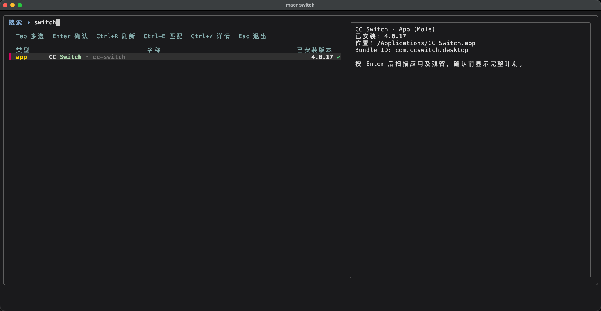
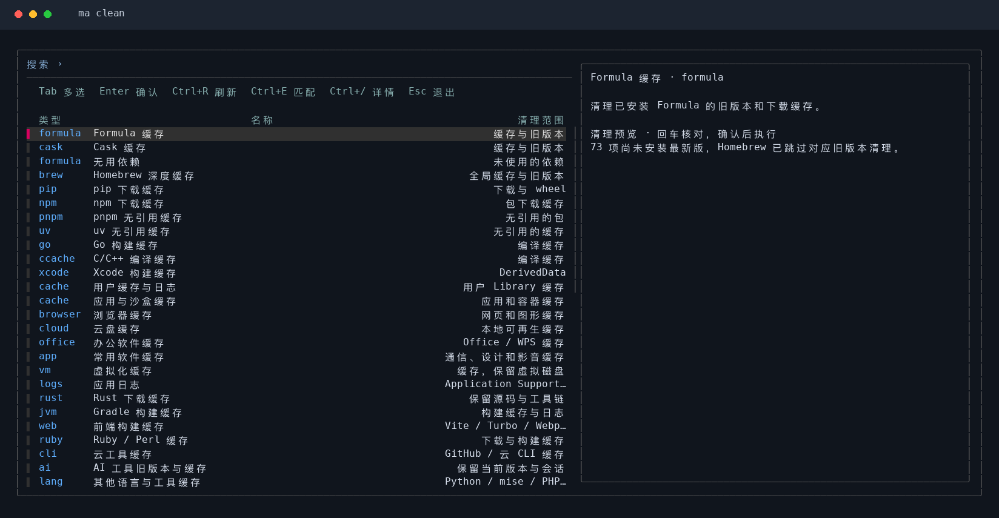
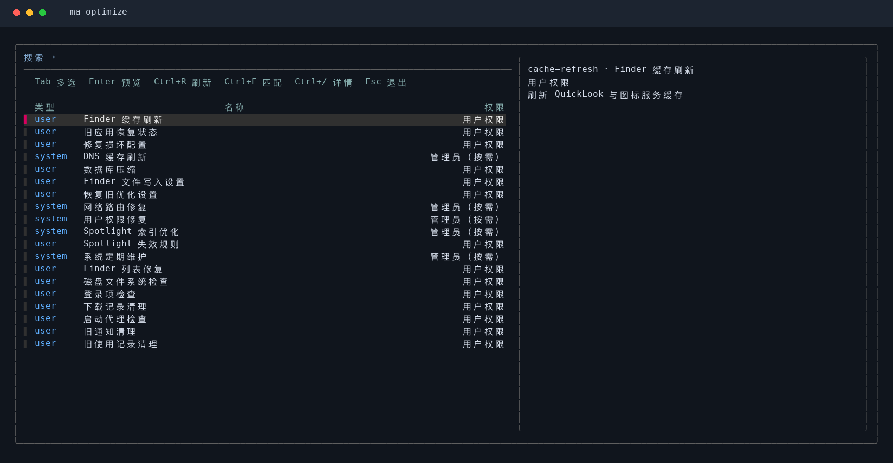

# mactools usage guide

Full details for installation, commands, cleanup scopes, and every feature. For a quick start see the [README](../README.en.md).

## Install and uninstall

Install with Homebrew to configure Python and fzf dependencies automatically:

```bash
brew install tingfeng347/tap/mactools
```

Alternatively, add the tap first:

```bash
brew tap tingfeng347/tap
brew install mactools
```

Upgrade or uninstall a Homebrew installation:

```bash
brew update
brew upgrade mactools
brew uninstall mactools
```

`brew uninstall mactools` removes the commands, shared modules, and shell completions. Caches are kept by default; remove them manually if desired:

```bash
rm -rf "${XDG_CACHE_HOME:-$HOME/Library/Caches}/mactools"
```

If you no longer use the tap, run `brew untap tingfeng347/tap`.

Tap: [tingfeng347/homebrew-tap](https://github.com/tingfeng347/homebrew-tap).

You can also clone the project and use the installer:

```bash
git clone https://github.com/tingfeng347/mactools.git
cd mactools
brew install python fzf       # Skip dependencies already installed
bash install.sh
```

If Homebrew, Python 3.9+, and fzf are already installed, use the standalone installer:

```bash
curl -fsSL https://raw.githubusercontent.com/tingfeng347/mactools/main/install.sh | bash
```

The script installs to `~/.local/bin` by default, without sudo. If this directory is missing from PATH, run the following and add it to your `~/.zshrc` as needed:

```bash
export PATH="$HOME/.local/bin:$PATH"
```

The installer can explicitly install dependencies or use a custom directory:

```bash
bash install.sh --install-deps
bash install.sh --bin-dir "$HOME/bin"
bash install.sh --dry-run
```

Install Homebrew separately using its [official instructions](https://brew.sh). The installer stages and validates all files before deploying commands and shared modules, and attempts to restore old files if deployment fails. You can also run `./bin/ma` or `./bin/maci` directly from the source directory.

```bash
bash uninstall.sh --dry-run
bash uninstall.sh
bash uninstall.sh --purge-cache
bash uninstall.sh --bin-dir "$HOME/bin"
```

If `brew uninstall mactools` reports that it is not installed but `ma` still runs, the current copy was installed by the script. Check `command -v ma` (usually `~/.local/bin/ma`), then run `bash uninstall.sh` from the repository. Without a checkout, run:

```bash
curl -fsSL https://raw.githubusercontent.com/tingfeng347/mactools/main/uninstall.sh | bash
```

The uninstaller removes only mactools commands and modules. It preserves applications, dependencies, AI logins and sessions, language settings, mirror snippets, and mirror backups. `--purge-cache` additionally removes the current user's mactools cache.

The standalone installer tries GitHub Raw and then jsDelivr, downloading and validating the full payload before deployment. Override download bases with `MACTOOLS_DOWNLOAD_BASES` (space separated).

## Interface demo

Search and select packages: white names, right-aligned versions, and green `✓` marks for installed packages. Blue types indicate official Homebrew sources; purple indicates third-party taps. Use `Tab` for multiple selections, `Ctrl+A` to select all matches, and `Ctrl+/` to toggle details.


<details>
<summary>More interfaces: app removal, disk cleanup, and system optimization</summary>

**App removal with `macr`**: native apps appear first with yellow `app` labels. Press Enter to scan leftovers, then choose whether to clean them before confirming removal.



**Disk cleanup with `macc`**: select Homebrew caches, unused dependencies, build output, and application caches; inspect the scope on the right.



**System optimization with `maco`**: choose from 19 tasks for DNS, system caches, and services, then review permissions and effects.



</details>

<details>
<summary>All commands and shortcuts</summary>


</details>

## Commands and shortcuts

| Feature | Full command | Shortcut |
|---|---|---|
| Search and install packages | `ma install` | `maci` |
| Remove packages, apps and leftovers | `ma remove` | `macr` |
| Review and update packages | `ma update` | `macu` |
| Check environment, caches, and connectivity | `ma doctor` | `macd` |
| Preview and clean disk space | `ma clean` | `macc` |
| Refresh caches and services, optimize system | `ma optimize` | `maco` |
| Benchmark, switch, and restore mirrors | `ma mirror` | `macm` |
| Manage AI coding tools | `ma ai` | `maca` |

```bash
ma --help
ma help mirror
ma update --help
ma --version
ma setup en                  # Save English as the interface language
ma setup zh                  # Save Chinese (the default)
```

`MACTOOLS_LANG=zh|en` temporarily overrides the saved language. Configuration defaults to `~/.config/mactools` and respects `XDG_CONFIG_HOME`.

## Search, install, remove, and update

```bash
maci firefox                 # Search Formula + Cask names and select interactively
maci --formula wget          # Command-line tools; --brew aliases --formula
maci --cask firefox          # macOS applications
maci --formula --cask python # Combine sources
maci --exact wget            # Contiguous substring matching; fuzzy by default
maci --list firefox          # List matches without opening the selector
maci --refresh               # Fetch the name catalog again

macr                        # Native apps first, then Homebrew packages
macr --apps                 # Native applications and leftovers only
macr --apps --app-data       # Include personal data in the reviewed plan
macr --apps --clean-leftovers # Uninstall apps and clean previewed leftovers
macr --apps --keep-leftovers # Uninstall apps and explicitly keep leftovers
macr --cask firefox          # Homebrew casks only
macr --dry-run firefox      # Show the removal plan after selection

macu                        # Select updates with current and target versions
macu --formula
macu --list                 # List available updates without changes
macu --dry-run              # Preview selected update commands
macu --refresh-index        # Confirm and run brew update before listing updates
```

Install, remove, and update operations display a plan and request confirmation. `--yes` skips only mactools confirmation; Homebrew retains its own transaction prompts. It never decides whether to clean app leftovers for you; scripts that want cleanup must pass `--clean-leftovers` explicitly. Commands never use `sudo brew`, and removal does not pass `--zap`.

The install selector shows package source, name, and installed version, with Homebrew details in the preview. The update selector shows installed and target versions. Search matches only names, excluding source, version, and installation status.

Keyboard hints and column headings appear on separate lines. Types use `formula` / `cask` for Homebrew packages and `app` for native applications in both languages. Wide terminals show details on the right; narrower terminals place them below. Preview labels follow the interface language, while package names and upstream descriptions retain their original text.

| Key | Action |
|---|---|
| `Tab` / `Shift+Tab` | Toggle selection and move down / up |
| `Ctrl+A` | Select all current matches |
| `Enter` | Continue to the operation plan and confirmation |
| `Ctrl+R` | Refresh the current list |
| `Ctrl+E` | Switch between contiguous substring and fuzzy matching |
| `Ctrl+/` | Show / hide package details |
| `Esc` | Exit and stop background package queries |

`macr` places native applications first with yellow `app` labels and white names. Homebrew `cask` / `formula` colors remain blue or purple. An app installed by a cask is shown once when the cask artifact's absolute target exactly matches the app bundle; the native `app` row remains available for leftover cleanup and keeps the cask token as a dim search alias, so `cc-switch` still matches it, while casks without a matching app bundle still appear separately. Application removal reuses Mole source and previews bundles and leftovers before confirmation. It then asks whether to clean the leftovers (kept by default); `--clean-leftovers` cleans them directly and `--keep-leftovers` always keeps them. Personal preferences and support data are kept by default; `--app-data` includes them in the cleanup scope. Native files move to Trash; Homebrew apps use `brew uninstall --cask`. Selecting both views of one app uninstalls it once. Any need for administrator access or quitting a running app is shown in the preview and acted on after confirmation. Explicit `--formula` / `--cask` filters select Homebrew packages; `--apps` selects native apps and can be combined with either filter.

`maci`, `macu` and `macr` first show a list snapshot from the last 24 hours, then refresh it in the background without restarting the selector. After an install, remove, or update runs, only the affected rows are patched in place: removed packages are dropped from the snapshot and installed or upgraded packages get their real version, so the rest of the cache stays warm and the next run is still fast. A snapshot is discarded and rebuilt live only when it is expired, corrupt, or cannot be patched safely. First use still loads live data. Search and selection remain available during refresh; recent fzf versions retain selected packages. Pressing Enter early waits for the refresh to verify the selection. Removed packages and updates no longer needed are skipped; cached state never authorizes a package change. Single-type `--formula` / `--cask` selectors can reuse a combined snapshot, and live queries request only the required type. Switching details cancels the old preview query to avoid accumulating background work. Name catalogs are cached for one hour; `Ctrl+R` forces a catalog refresh. Cache defaults to `~/Library/Caches/mactools` and respects `XDG_CACHE_HOME`. `--list` always uses live state. `--list` and `--dry-run` neither write mactools cache nor change packages.

Package queries time out after 15 seconds per request by default; adjust with `--timeout 30`. App details show metadata immediately; leftover discovery starts after Enter, with a separate 120-second budget per app, added together for multiple selections. Adjust it with `macr --scan-timeout 240`. A timed-out scan cancels the plan without uninstalling anything. Only an explicit `ma update --refresh-index` refreshes the Homebrew index. It cannot be combined with `--list` or `--dry-run`.

Installed Cask versions prefer the application's own version, falling back to the Homebrew installation record when unavailable. Details separate the installed version, Homebrew record, Homebrew available version and tap. After an app updates itself, `macu` skips Homebrew versions confidently identified as equal or older. Build-qualified versions also check build numbers; formats that cannot be compared reliably retain Homebrew's update decision. Homebrew availability may lag behind the app's own updater.

## Diagnostics and cleanup

```bash
macd
macd --offline               # Local checks only
macd --formula --timeout 5

macc                         # Select cleanup actions, preview, then confirm
macc --list                  # List cleanup actions only
macc --dry-run               # Preview without deleting files
macc --cask --dry-run
macc --dev                   # Developer-tool and build caches only
macc npm-cache --dry-run     # Preview npm downloads only
macc autoremove              # Preview and confirm unused Homebrew dependencies
macc brew-cache --dry-run    # Preview deep Homebrew cleanup
macc browser-cache --dry-run # Preview Mole browser-cache rules
macc ai-cache               # Preview and confirm AI versions and caches
macc project-artifacts --dry-run # Inactive dependencies and build output
```

Diagnostics report dependencies, architecture, Homebrew prefix, Xcode Command Line Tools, package lists, cache age, and connectivity using `OK`, `WARN`, `FAIL`, or `SKIP`, with elapsed time. `FAIL` returns a nonzero exit status. Missing optional tools are marked `SKIP`; Homebrew's own recommendations are marked `WARN`.

Select from the following actions, then preview and confirm:

| Action ID | Scope |
| --- | --- |
| `formula-cache` / `cask-cache` | Old installed versions and removable Homebrew caches |
| `autoremove` | Formula dependencies Homebrew considers no longer needed |
| `brew-cache` | Global Homebrew cleanup with `cleanup --prune=all --scrub`; downloads for installed packages are retained |
| `pip-cache` | pip HTTP and wheel caches |
| `npm-cache` | npm package downloads |
| `pnpm-store` | Unreferenced packages in the pnpm store |
| `uv-cache` | Dangling uv cache entries and cached environments |
| `go-cache` | Go build cache, preserving downloaded modules |
| `ccache` | C/C++ compilation cache, preserving configuration |
| `xcode-derived` | Default `~/Library/Developer/Xcode/DerivedData` build cache, preserving Archives and device data |
| `user-cache` / `app-cache` | User Library caches, logs and sandboxed application caches |
| `browser-cache` | Browser web, code and graphics caches |
| `cloud-cache` / `office-cache` | Rebuildable cloud-storage and Office / WPS caches |
| `app-tools` / `vm-cache` / `app-logs` | Utility-app caches, virtualization caches and logs; VM disks are preserved |
| `rust-cache` / `jvm-cache` / `frontend-cache` / `ruby-cache` | Rust, Gradle, frontend build and Ruby / Perl caches |
| `cloud-cli-cache` / `build-tools-cache` / `language-cache` | Cloud CLI, build, CI, shell and other language-tool caches |
| `ai-cache` / `editor-cache` | AI tool superseded versions and caches, editor caches and logs |
| `xcode-extra` | Xcode documentation caches and eligible XCTest devices |
| `project-cache` | Rebuildable project caches, with tracked-file and nested-repository guards |
| `project-artifacts` | Dependencies and build output inactive for at least 7 days and passing activity/content checks |
| `installers` | Installer DMG, PKG, ISO, XIP and similar files under home; ZIPs must contain installer content |
| `trash` / `saved-state` | Trash and closed-app window restoration state |
| `recent-items` / `finder-metadata` | Review recent records and Finder metadata; preserve history and `.DS_Store` protected by Mole |
| `mail-downloads` / `incomplete-downloads` | Old Mail download copies and idle incomplete downloads |
| `old-app-versions` / `orphan-app-data` / `orphan-services` | Old app versions, app leftovers and stale system registrations |
| `system-cache` / `group-cache` / `silicon-cache` | Old system, group container and Rosetta / Metal caches |
| `device-firmware` / `failed-backups` | Old firmware downloads and stale inactive incomplete backups |
| `mobile-cache` / `toolbox-cache` / `nix-garbage` | Unavailable simulators and device support, old Toolbox versions and dead Nix store paths |
| `local-snapshots` / `system-updates` / `large-files` | Review snapshots, update staging and large files without automatic deletion |
| `periodic-maintenance` / `disk-verify` | System periodic tasks and filesystem verification; disk verification requires `MOLE_ENABLE_DISK_VERIFY=1` |

Homebrew uses its native `--dry-run`. Developer-cache previews only query paths and perform a bounded size scan; they never invoke cleanup commands. Sizes show current cache totals, not estimated savings. Missing optional tools show `SKIP`. Future installs or builds may recreate caches; stop Xcode builds before cleaning DerivedData.

`--formula` / `--cask` restrict cleanup to the corresponding Homebrew actions. `--dev` selects developer actions without requiring Homebrew and cannot be combined with those flags. Cleanup does not use `--zap`. Ordinary cache actions preserve personal app data, sources and Xcode Archives. Trash, Mail downloads, recent items and saved state are separate opt-in categories that identify the affected data. `project-artifacts` can remove eligible inactive `node_modules`, `.venv`, `target`, `dist` and similar directories after preview and confirmation; dependencies or build output will need to be recreated.

Extended cleanup bundles and reuses [Mole](https://github.com/tw93/Mole) source; no separate Mole installation is required. Upstream whitelist, process, open-file and path guards are retained. Preview scans without deleting; apply additionally checks the previewed target identities and skips new or replaced targets. mactools provides the selector and confirmation; detailed Mole diagnostics retain upstream English text. System cache and orphan-service actions request administrator access after confirmation when needed; previews do not request access. Snapshot, OS update staging and large-file actions only review or suggest candidates without deleting them, matching the vendored Mole version.

Protect paths in `~/.config/mactools/mole/whitelist`, one absolute path per line (`~` is supported). Cleanup records are under `~/Library/Logs/mactools/mole/`, isolated from a separate Mole installation. Preview can write tool-owned diagnostics and temporary scan files, but never deletes cleanup targets. See [Mole integration](MOLE.md) for the pinned source, coverage and rebuild steps. Distributed under [GPL-3.0](../LICENSE); attribution is in [NOTICE](../NOTICE.md).

The cleanup menu opens before querying installed packages. Selection and preview query only the chosen package type; `autoremove` needs no package listing. Execution uses a freshly generated cleanup plan.

The cleanup selector follows `maci`: search at the top, aligned type/name/scope columns, and descriptions with previews on the right. Use `Ctrl+/` to toggle details and `Ctrl+A` to select all. Repeated warnings about packages without the latest version installed are grouped in the details pane; the full plan and confirmation still appear before cleanup.

## System optimization

```bash
maco                              # Select tasks, preview, then confirm
ma optimize --list                # List tasks without scanning the system
maco cache-refresh --dry-run      # Preview QuickLook and icon-cache refresh
maco network-optimization         # Refresh DNS after VPN checks
maco sqlite-vacuum --dry-run      # Preview database compaction
```

Reuses Mole's 19 optimization tasks without a separate `mo` installation. The selector follows the `maci` search, multi-select and detail layout. Opening it performs no optimization. `--dry-run` previews only; confirmed runs execute selected tasks and request administrator access only when needed. Noninteractive runs default to preview; applying requires explicit `--yes`.

| Tasks | Effects |
| --- | --- |
| `cache-refresh` / `saved-state-cleanup` | Refresh QuickLook and icon caches; remove app states older than 30 days |
| `fix-broken-configs` / `shared-file-list-repair` | Repair corrupted preferences and eligible Finder shared lists; preserve recent-document data |
| `network-optimization` / `network-stack-optimize` | Refresh DNS, routing and ARP caches; may briefly reconnect networking; retains VPN checks |
| `sqlite-vacuum` | Compact Mail, Safari and Messages databases; skip running apps |
| `prevent-network-dsstore` / `legacy-overrides-audit` | Set persistent Finder preferences for network/external volumes; audit old hidden overrides |
| `disk-permissions-repair` | Detect and repair user-directory permissions using upstream rules |
| `spotlight-index-optimize` / `spotlight-orphan-rules-cleanup` | Rebuild Spotlight indexes when needed; remove orphaned app search rules |
| `periodic-maintenance` / `disk-verify` | Run supported maintenance; explicitly enabled filesystem verification does not repair disks |
| `login-items-audit` / `launch-agents-cleanup` | Audit broken login items and LaunchAgents, retaining upstream report-only behavior |
| `quarantine-cleanup` / `notification-cleanup` / `coreduet-cleanup` | Process download tracking, old notifications and usage records using upstream rules |

Details and the final preview explain persistent preference changes, history processing and service refreshes. Filesystem verification requires `MOLE_ENABLE_DISK_VERIFY=1`. Detailed diagnostics retain upstream wording. See [Mole integration](MOLE.md) for source and protection details.

## Mirrors

```bash
macm                         # Benchmark, then confirm whether to apply
macm test                    # Benchmark only
macm test --json
macm auto --dry-run          # Preview the fastest mirror configuration
macm auto                    # Back up, confirm, and apply the fastest mirror
macm restore                 # Restore the most recent configuration
macm restore --dry-run
macm restore --force         # Explicitly allow overwriting manual snippet edits
```

Default candidates are official GHCR, Tsinghua, and USTC, with up to four concurrent checks. The benchmark uses the official Homebrew API to find a `hello` bottle, preferring the local architecture and falling back to another macOS architecture when unavailable (samples are never executed), verifies the complete sample's SHA-256, and compares download speeds using the same sample. Samples are limited to 8 MiB; results reflect small-file performance on the current network. The selected mirror's API is also checked before applying it.

```bash
macm test --mirror official --mirror tuna --timeout 5 --limit 4
macm test --mirror https://your-mirror.example/homebrew-bottles
```

Custom mirrors must provide standard Homebrew bottle paths. Automatic switching also requires Homebrew API endpoints under `/api`.

Mirror switching writes a shell-specific snippet without editing shell startup files: bash/zsh use `~/.config/mactools/mirrors.sh`, and fish uses `~/.config/mactools/mirrors.fish`. After completion, the command displays the `source` command for your current terminal:

```sh
source "$HOME/.config/mactools/mirrors.sh"
```

In fish:

```fish
source ~/.config/mactools/mirrors.fish
```

Add this `source` line to your shell configuration to enable it in new terminals. Backups default to `~/Library/Application Support/mactools` and respect `XDG_STATE_HOME`. Use `--config-dir` and `--state-dir` for isolated directories. Writes are locked and rolled back on failure. Restore validates the backup and current snippet, refusing to overwrite manual edits unless `--force` is explicitly supplied.

This changes bottle and API download domains. The Homebrew installer, third-party tap Git remotes, and upstream Cask download URLs remain managed by their respective projects. If official reference data cannot be fetched, benchmarking fails and preserves the existing configuration.

## AI coding tools

```bash
maca                         # Open the install selector
maca install codex claude opencode pi qodercn gemini qwen zcode
maca install --all --dry-run
maca status                  # Local versions, sources, and all installed copies
maca status --latest          # Also query the latest npm releases
maca update                  # Select installed tools to update
maca update codex --check     # Check upstream versions without updating
maca update --all
maca remove                  # Select copies to remove by installation path
maca remove codex --path "$HOME/.local/bin/codex"
maca remove --all --dry-run
maca doctor --offline
```


Supports Codex, Claude Code, OpenCode, Pi, Qoder CN, Gemini CLI, Qwen Code and official ZCode CLI. The selector matches `maci`, with a centered name heading, left-aligned names, aligned status/source columns and a details pane toggled with `Ctrl+/`.

Codex, Claude, OpenCode, Pi and Qoder CN use official installer scripts, downloaded before execution. Gemini and Qwen use official npm packages. Qoder CN recognizes both `qodercn` and the legacy `qoderclicn` binary. Updates follow the detected Homebrew, npm, pnpm, Bun or native installation method.

ZCode CLI follows the [official source-build workflow](https://github.com/zai-org/ZCode#readme). It requires Git, Node.js 24.14+ and the repository-pinned pnpm (currently 10.33.2); builds can take some time. The build runs in a temporary directory before switching the runtime under `~/.local/share/mactools/zcode` and creating `~/.local/bin/zcode`. Failed builds preserve the previous version; removal preserves `~/.zcode`. Preview with `maca install zcode --dry-run`.

Homebrew installations are identified by their actual target files, Formula/Cask names, and installation directories to avoid mixing Intel and Apple Silicon Homebrew installations. Symlinks to the same executable are merged into one entry; distinct copies are displayed separately. Unknown installation sources are not automatically updated or removed. Removal preserves client configuration, credentials, and sessions.

`status --latest` and `update --check` compare the official source version for ZCode and upstream npm SemVer for other tools, which can differ from Homebrew or native release channels. Without fzf, specify client names or `--all` directly. The AI selector supports `Tab` to toggle selection, `Ctrl+A` to select all, `Ctrl+D` to deselect all, `Enter` to continue, and `Esc` to exit.

AI status, version and connectivity checks run for up to four tools concurrently, with results displayed in request order. Download endpoint checks read only the first 1 KiB. Plain `status` and `doctor --offline` make no network queries; installation, updates and removal still run sequentially.

## Shell completion

```bash
# Bash
source <(ma completion bash)

# Zsh
autoload -Uz compinit && compinit
source <(ma completion zsh)

# Fish
ma completion fish | source
```

Completion covers `ma` and all eight shortcuts, without network queries during completion.

## Development and validation

See the [functional specification](SPEC.md) for scope and development contracts, and the [review report](REVIEW.md) for the initial integration review.

```bash
python3 -m unittest discover -s tests -v
```

Tests use temporary directories, fake package managers, local HTTP servers, and pseudo-terminals without installing, updating, or removing actual host software. Local regression checks cover real fzf name filtering and cleanup bindings. CI checks Python 3.9 and 3.13 on macOS and Linux; installer lifecycle tests run only on macOS. See the CI badge above for remote results.

macOS adaptation references: [Homebrew commands](https://docs.brew.sh/Manpage), [Homebrew JSON API](https://docs.brew.sh/Querying-Brew), [Tsinghua bottle mirror](https://mirrors.tuna.tsinghua.edu.cn/help/homebrew-bottles/), and [USTC bottle mirror](https://mirrors.ustc.edu.cn/help/homebrew-bottles.html).
